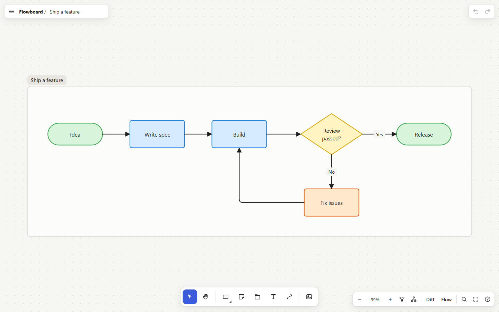
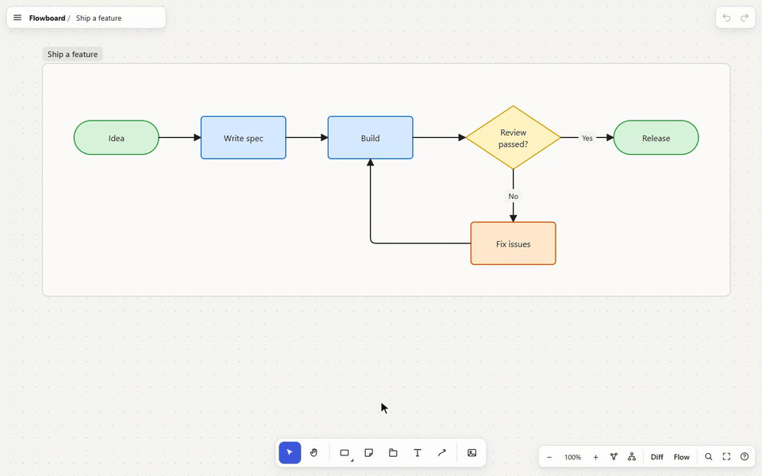
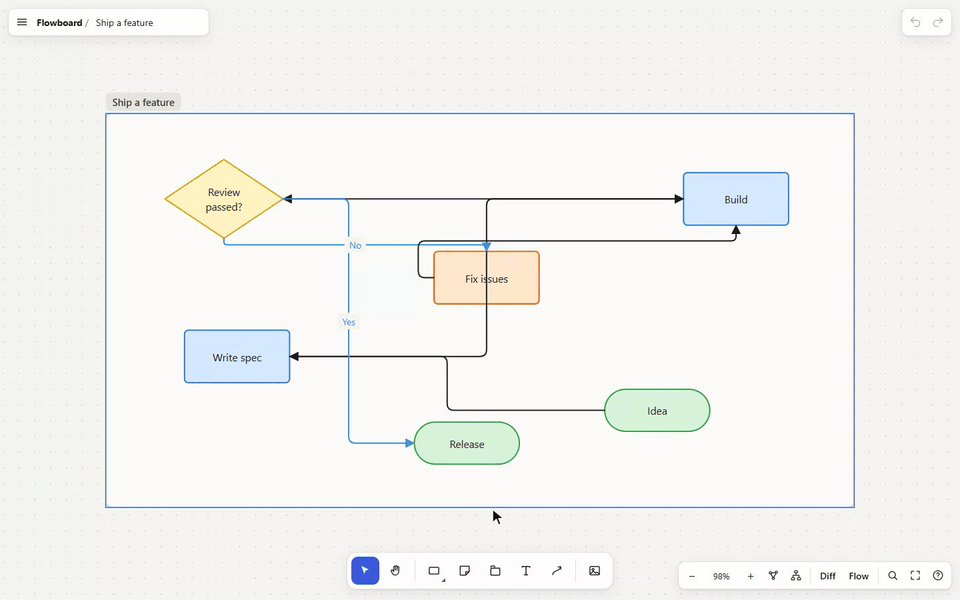

# Flowboard

Live demo: https://kashihashi95.github.io/flowboard/



A FigJam-style flowchart editor that runs entirely in the browser, with no account and no server.

## The problem it solves

Online whiteboards need an account, keep your diagrams on someone else's server, and can't easily be written or read by an AI assistant. Flowboard keeps every board on your own machine (browser storage, a local workspace folder, or a single self-contained HTML file) and round-trips boards through a plain Markdown format that both people and AI tools can write by hand.



*Drag a connector out of a shape and let go on empty canvas: a new shape appears, already connected.*



*Tidy up (Shift+T) turns a messy board into a neat layered flowchart.*

## Tech stack

- React 19 + TypeScript
- Vite 8 (with `vite-plugin-singlefile` for the one-file HTML build)
- SVG rendering, Canvas for PNG/JPG/PDF export, File System Access API for workspace folders
- oxlint for linting

## Build and run

Requires Node.js 20.19+ or 22.12+.

```bash
npm install
npm run dev          # http://localhost:5173
npm run build        # static site in dist/
npm run build:single # one self-contained HTML file in dist-single/
npm run preview      # serve the dist/ build locally
```

## Configuration

None. There are no environment variables, API keys or servers: boards autosave to the browser's local storage and can be saved to a folder you choose.

## How I built it

I built Flowboard with Claude Code, directing the agent feature by feature and reviewing each change. It is a single-page React app with no backend; the Flowboard Markdown format ([FLOWBOARD-MARKDOWN.md](FLOWBOARD-MARKDOWN.md)) was designed so an assistant can generate or edit a whole board as text.

## Features

### Canvas & shapes

- Unbounded canvas with smooth zoom from 2% to 1600%: scroll to pan, Ctrl/⌘ + scroll or pinch to zoom, hold Space or use the hand tool to drag.
- Flowchart shapes: process, terminal, decision, ellipse, input/output, database, preparation, plus sticky notes and free text.
- Select, marquee-select, move with alignment guides, resize, Alt-drag to duplicate, copy/paste, layer order, arrow-key nudging.
- 11 fill colors, separate outline color/thickness/dashes, shape switching, any text size (type a number).
- Sections like FigJam: draw one (Shift+S) or wrap the selection in a new section (Ctrl/⌘+Alt+G); moving, copying or exporting a section brings its contents.
- Images: paste from the clipboard, drag files onto the board, or upload; resize keeps proportions.
- Snapping: while you drag a shape, it snaps into line with a connected shape so the connector runs straight (and a dragged connector segment snaps into line with the others).
- Auto-size: shapes grow wider as you type (then wrap and grow taller) and shrink back when text is removed. Resize a shape by hand to fix its width; it then only grows taller.
- Physics (Shift+P or the graph button): connected shapes pull together and others push apart, like Obsidian's graph view; drag shapes around while it runs. One undo step reverts it.
- Tidy up (Shift+T or the button beside Physics) rearranges the board into a layered flowchart (sections kept together and in order) and routes every connector around shapes and words, in separate lanes, with ports spread along each side.
- Light and dark mode follow the system setting.

### Connectors

- Connectors that stay attached when shapes move, with elbow, curved or straight routing, arrowheads at either end, dashed lines, three thicknesses and labels.
- Hover a shape and drag one of its blue dots to connect it; click a dot to add the next step in that direction, already connected.
- Drag a connector out of a shape and let go on empty canvas: a new shape appears there, connected, ready for its text. Shift+click a shape to edit its text straight away; Ctrl/⌘+click adds to the selection.
- Eight arrowhead styles for either end of a connector.
- Connector segments: select an elbow connector and drag the handle on any straight piece to slide it, like FigJam; clicking the Elbow style again resets the route.
- Attaching anywhere: drop a connector end on a shape's outline and it stays where you dropped it; near the middle of a side it snaps firmly to that side's anchor; dropped deeper inside, it picks the best side.
- Shared trunks: connectors leaving the same point (or arriving at one) bend at the same place, so their shared stretch is one overlapping line.
- Loose ends: select a connector whose end isn't attached and pick a shape from its toolbar to add that shape there, already connected.
- Crossing connectors: when a connector crosses another of the same color, it is shown in a hue of its own (connectors that share a shape are left alone). Turn it off in the menu: Color crossing connectors.
- Go to the other end: select a connector and press the jump button in its toolbar (Shift+J) to pan to its far end at the current zoom; press again to come back. With several connectors, or a shape selected, it zooms out to fit every shape at the other ends. The shapes you land on glow for 5 seconds.

### Text & links

- Rich text in shapes: bold, italic, underline, strikethrough, text color, alignment, bulleted and numbered lists.
- Link points: while editing text, select words and press Ctrl/⌘+Shift+K (or the link button); drag the small dot after them to attach a connector to exactly that phrase, or drop a connector end onto it. Drag straight out of highlighted words to draw a connector from them (the filled dot beside the words works too).
- Reuse a link: while editing text, type `/` to list the links already on the board; keep typing to narrow it, then pick one with Enter, Tab or a click. It is inserted as a link point and joined by a dashed connector to every other place that link appears.
- While editing, resting the pointer on words that are a link elsewhere on the board shows a small "Link" chip; click it to make them a link point joined to the other copies.

### Export & saving

- Export like FigJam: the entire board or just the selection, as PNG, JPG, SVG or PDF, at 0.5×–4×, with or without a background. Copy as PNG (Ctrl/⌘+Shift+C), and save/open a local copy as JSON.
- Exports: PNG and PDF are drawn in tiles and stitched, so any board exports at 4x detail; JPG steps down only if the browser can't draw it. With a workspace set, Save and Export write into the workspace folder.
- HTML export: Flowboard itself with the board built in, as one file you can double-click to open and keep editing.
- Markdown (.md) import and export in Flowboard Markdown, a hand-writable format covering every feature (see FLOWBOARD-MARKDOWN.md). Boards written without positions are laid out automatically; exports include a Mermaid preview for Obsidian.
- Saving everything: .md (what Save to workspace writes) holds the whole board, plus a hidden history block at the end with the timeline (each track point stored as the changes since the one before, pictures stored once), the view and the toggles. A Flowboard .html (Export → HTML, which goes into the workspace folder when one is set) also carries the timeline's track points, the view and the Diff, Flow and crossing-color toggles; open it directly or with Open file. Older .json saves still open. Menu → Download Markdown guide saves FLOWBOARD-MARKDOWN.md from the app itself.
- Workspace folder (Chrome/Edge): Menu → Workspace to choose a folder. It lists the charts in it; Ctrl+S saves back to the open file (or a new .md named after the board), Ctrl+Shift+S saves under a new name. The folder is remembered; the browser asks once per visit to use it again.
- Workspaces: the Workspace panel lists every folder you've used, to switch between them.

### Review & history

- Undo/redo for every change.
- Find on the board (Ctrl/Cmd+F or the magnifier at bottom right) searches every shape, section title and connector label, ignoring capitals, accents and formatting. Results are grouped by section; clicking one (or Enter / Shift+Enter) brings it into view at a readable zoom, and the matches stay highlighted on the board.
- Track points and Diff: the Diff button (bottom right) has **Start track**, which saves the board as it is now as a track point. Diff compares with the latest track point: "Highlight changes on the board" (Shift+D) shows what's new or edited since then. Opening a file starts its history with an "Opened" point. **Timeline** lists every point (rename one with ✎ or by double-clicking its name): pick one to see what changed since then, or two to compare them, with removed things shown in red. **Export diff…** there exports what the picked comparison shows as new or edited (plus the shapes a new connector joins), in any format.
- Flow view: the Flow button (bottom right, Shift+F) runs dots along every connector the way its arrow points (both ways when it has arrows at both ends). It only shows on screen, never in exports.

### Touch

- Touch and phones (built for the Galaxy Z Fold: folded cover screen and unfolded inner screen): pinch to zoom, one finger to pan or move shapes, double-tap to edit, hold for a menu (edit, duplicate, delete, select several, select an area, paste). Handles and buttons grow on touch screens. On a narrow screen the style bar docks under the top bar, the zoom bar folds into a "⋯" button and menus slide up from the bottom. Folding or unfolding keeps the middle of the board in place. Help (?) lists the gestures.

Press `?` in the app for the full shortcut list.

## Code map

| File | What's in it |
| --- | --- |
| `src/types.ts` | Document model (shapes, connectors), color palette |
| `src/geometry.ts` | Anchors, connector routing, text wrapping, bounds |
| `src/store.ts` | Undo/redo history, document operations, local storage, example board |
| `src/render.tsx` | SVG drawing of shapes and connectors (also used for export) |
| `src/richtext.ts` | Rich text model, wrapping/layout, editor HTML conversion |
| `src/TextEditing.tsx` | Rich text editor, formatting toolbar, font size box |
| `src/images.ts` | Reading and shrinking image files |
| `src/App.tsx` | Canvas interaction, toolbars, style bar, dialogs |
| `src/exporter.ts` | SVG, PNG, JPG and PDF rendering, downloads, clipboard |
| `src/ExportPanel.tsx` | The export dialog |

## License

MIT. See [LICENSE](LICENSE).
